<p align="center">
  
</p>

<p align="center">
  
</p>

<p align="center">
  I'm <b>Envy</b> — a curious mind building tools with a little neon and a lot of intention.<br />
  Local intelligence, systems worth exploring, and a way back when something breaks.<br /><br />
  <i>A little shell magic. I still eat glitter. ✨</i>
</p>

<p align="center"></p>

<p align="center"></p>

<p align="center">
  <a href="#featured"><b>Featured</b></a> &nbsp; · &nbsp;
  <a href="#working"><b>Working on</b></a> &nbsp; · &nbsp;
  <a href="#apps"><b>All apps</b></a> &nbsp; · &nbsp;
  <a href="#veil"><b>BLACK VEIL</b></a> &nbsp; · &nbsp;
  <a href="#signal"><b>Stats</b></a> &nbsp; · &nbsp;
  <a href="#find"><b>Find me</b></a>
</p>

<p align="center"></p>

<a name="featured"></a>
<p align="center"></p>

<p align="center">
  <a href="https://github.com/xzchick/envy-tools"></a>
  <a href="https://github.com/xzchick/envy-terminal"></a>
  <a href="https://github.com/xzchick/envy-black-veil"></a>
</p>

**Start here:** [ENVY Tools](https://github.com/xzchick/envy-tools) installs every app below, checking each download's SHA-256 and Sigstore signature first.

```sh
# macOS
brew install --cask xzchick/envy/envy-tools
# Linux
curl -fsSL https://raw.githubusercontent.com/xzchick/envy-tools/main/install.sh | sh
# then pick your apps
envy-tools install vault terminal hash
```

<sub>Windows: download ENVY Tools from its <a href="https://github.com/xzchick/envy-tools/releases/latest">latest release</a>. Every app also has its own page on the <a href="https://xzchick.github.io/homebrew-envy/">suite site</a>.</sub>

<a name="working"></a>
<p align="center"></p>

<p align="center"></p>

<p align="center"></p>

<a name="apps"></a>
<p align="center"></p>

**Sixteen apps** for privacy, security and analysis, each built and tested for **macOS, Windows and Linux** with signed releases. Native apps, not web pages; no telemetry and no accounts. Everything except Recon and Tunnel works fully offline.

<p align="center"></p>

<p align="center">
  <a href="https://github.com/xzchick/envy-vault"></a>
  <a href="https://github.com/xzchick/envy-veil"></a>
  <a href="https://github.com/xzchick/envy-tunnel"></a>
  <a href="https://github.com/xzchick/envy-crypto-workbench"></a>
</p>


<p align="center"></p>

<p align="center">
  <a href="https://github.com/xzchick/envy-recon"></a>
  <a href="https://github.com/xzchick/envy-casebook"></a>
  <a href="https://github.com/xzchick/envy-evidence-vault"></a>
  <a href="https://github.com/xzchick/hash-audit"></a>
</p>


<p align="center"></p>

<p align="center">
  <a href="https://github.com/xzchick/envy-integrity-monitor"></a>
  <a href="https://github.com/xzchick/envy-skywatch"></a>
  <a href="https://github.com/xzchick/envy-orbit"></a>
  <a href="https://github.com/xzchick/envy-ops-desk"></a>
</p>


<p align="center"></p>

<p align="center">
  <a href="https://github.com/xzchick/envy-terminal"></a>
  <a href="https://github.com/xzchick/envy-hypothesis"></a>
  <a href="https://github.com/xzchick/envy-oracle"></a>
  <a href="https://github.com/xzchick/envy-tools"></a>
</p>

<sub>Vault protects files; the Crypto Workbench is for reversible encodings and teaching ciphers, not security. Hash Audit is for hashes you own or are authorized to test.</sub>

<p align="center"></p>

<a name="veil"></a>
<p align="center"></p>

<p align="center">
  
  
  <a href="https://github.com/xzchick/envy-black-veil/releases/latest"></a>
</p>

**My own Linux OS, as a standalone, buildable OS.** AlmaLinux 10 + KDE Plasma 6, themed end to end in ENVY neon: GRUB, the boot splash with its LUKS passphrase prompt, the login screen, the desktop and the terminal. It ships as *just the OS*, and every ENVY app installs onto it with one command, `envy-tools install all`. Install it onto an external SSD, HDD or USB drive and boot it on almost any PC, or try it in a VM with one command on Windows, macOS or Linux. ISOs for PCs and Apple Silicon Macs; every build is booted, installed with full-disk encryption and checked in VMs, with Secure Boot on too. SELinux enforcing, the firewall on, nothing listening, nothing phoning home.

<table>
  <tr>
    <td width="50%" valign="top">
      <a href="https://github.com/xzchick/envy-black-veil"></a>
      <p><b>A desktop with its own identity.</b> AlmaLinux + KDE Plasma, searchable utilities, live command output, and a cohesive dark interface.</p>
      <p><code>AlmaLinux</code> <code>KDE Plasma</code> <code>Python</code> <code>RPM</code></p>
    </td>
    <td width="50%" valign="top">
      <a href="https://github.com/xzchick/envy-black-veil"></a>
      <p><b>Make recovery visible.</b> A 1,024-block recovery map driven by GNU ddrescue progress for disk-image recovery.</p>
      <p><code>Python</code> <code>Qt</code> <code>GNU ddrescue</code></p>
    </td>
  </tr>
</table>

<p align="center"><a href="https://github.com/xzchick/envy-black-veil/releases/latest"><b>Download v0.1.0 →</b></a> &nbsp; · &nbsp; <a href="https://github.com/xzchick/envy-black-veil"><b>Explore BLACK VEIL →</b></a></p>

<details>
<summary><b>Inside the workshop — development screenshot</b></summary>
<br />

[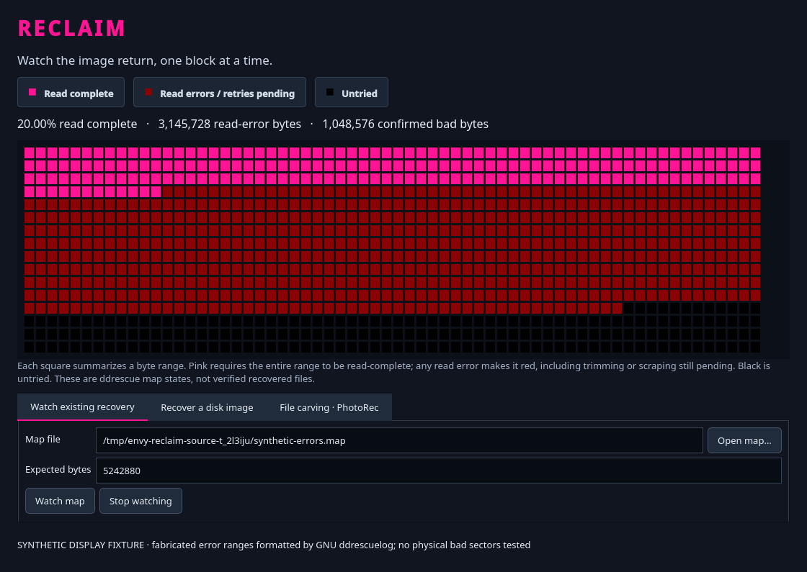](./reclaim-development.png)

<sub>Synthetic recovery-map test data; not a real disk recovery result.</sub>
</details>

<p align="center"></p>

<a name="signal"></a>
<p align="center"></p>

<p align="center">
  
  
</p>

<p align="center"></p>

<p align="center">
  
  
</p>

<p align="center"></p>

<details>
<summary><b>✶ View the whole skyline</b></summary>
<br />
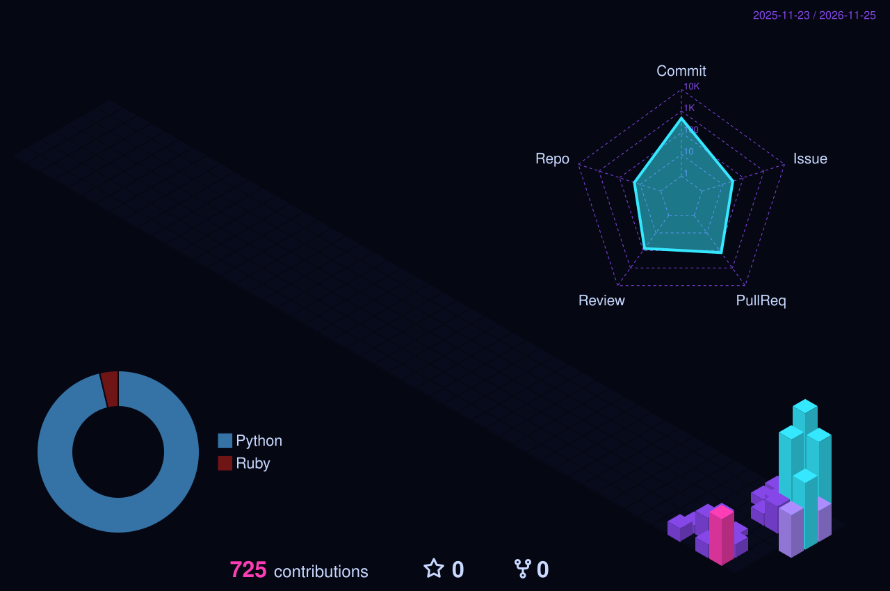
</details>

---

<a name="find"></a>
<p align="center"></p>

<p align="center">
  <a href="https://www.instagram.com/xzchick"></a>
  <a href="https://www.tiktok.com/@xzchik"></a>
  <a href="https://x.com/xzchick"></a>
  <a href="https://www.twitch.tv/xzchick"></a>
  <a href="https://linktr.ee/xzchick"></a>
</p>

<p align="center">
  
</p>
