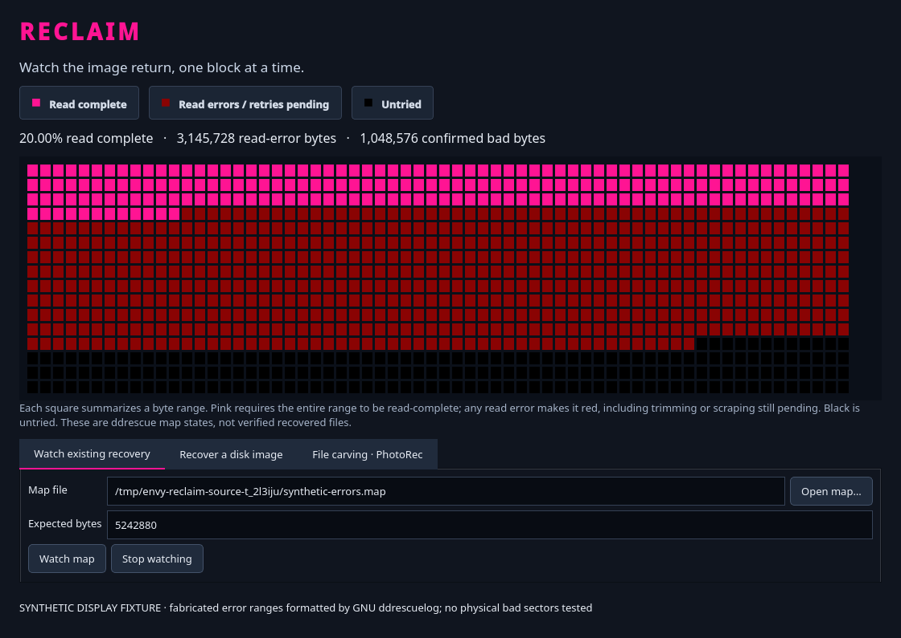
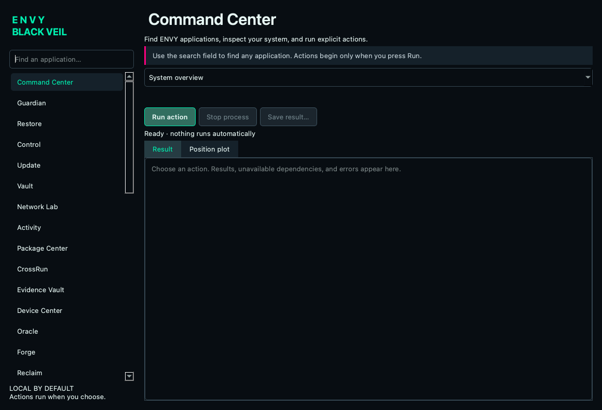
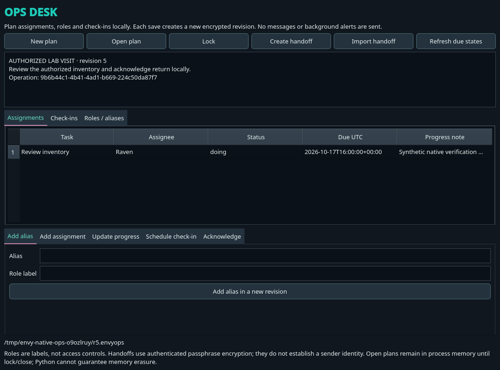

  

  <b>LOCAL AI &nbsp; / &nbsp; LINUX &nbsp; / &nbsp; RECOVERY &nbsp; / &nbsp; PRIVACY</b>

  <a href="#-featured-envy-terminal">Terminal AI</a> &nbsp; · &nbsp;
  <a href="#-the-black-veil-workshop">BLACK VEIL</a> &nbsp; · &nbsp;
  <a href="#-find-me-elsewhere">Find me</a>

  I'm <b>Envy</b> — a curious mind building tools with a little neon and a lot of intention. 
  Local intelligence, systems worth exploring, and a way back when something breaks.  
  <i>A little shell magic. I still eat glitter. ✨</i>

---

## ✦ Featured: ENVY Terminal

**My AI workspace, entirely in Terminal.** Fast local answers, a deeper Fable mode, searchable documents, and research with sources you can inspect.

<table>
  <tr>
    <td width="33%" valign="top"><b>⌘ THINK LOCALLY</b>
Switch between quick everyday chat and detailed work. Models run on your Mac.
<code>/fast</code> &nbsp; <code>/deep</code></td>
    <td width="33%" valign="top"><b>▧ FOLLOW THE EVIDENCE</b>
Search PDFs, read scanned pages with local OCR, and distinguish facts from allegations.
<code>/library-find</code> &nbsp; <code>/check</code></td>
    <td width="33%" valign="top"><b>◇ KEEP CONTROL</b>
Save chats deliberately, choose what to remember, and turn web research off.
<code>/chat-save</code> &nbsp; <code>/offline</code></td>
  </tr>
</table>

  <a href="https://github.com/xzchick/envy-terminal"><b>Explore ENVY Terminal →</b></a> &nbsp; · &nbsp;
  <a href="https://github.com/xzchick/envy-terminal/blob/main/docs/SETUP.md">Install it</a> &nbsp; · &nbsp;
  <a href="https://github.com/xzchick/envy-terminal/blob/main/docs/COMMANDS.md">Command guide</a>

<b>See it in Terminal</b>

 

Illustrative terminal render using a fictional fixture and real indexing output. No personal documents or account information are shown.

macOS-first · Python · Ollama · SQLite · Vision OCR · Local inference has no provider token bill. Online research still contacts external sources; model answers require verification.

## ✧ The BLACK VEIL workshop

A Linux environment and a growing set of tools for system visibility, recovery, and deliberate control.

<table>
  <tr>
    <td width="50%" valign="top">
      
      
<b>A desktop with its own identity.</b> AlmaLinux + KDE Plasma, searchable utilities, live command output, and a cohesive dark interface.

      
<code>AlmaLinux</code> <code>KDE Plasma</code> <code>Python</code> <code>RPM</code>

      Development candidate · Installer and desktop testing in progress.
    </td>
    <td width="50%" valign="top">
      
      
<b>Make recovery visible.</b> A 1,024-block recovery map driven by GNU ddrescue progress for disk-image recovery.

      
<code>Python</code> <code>Qt</code> <code>GNU ddrescue</code>

      In development · Part of the BLACK VEIL toolset.
    </td>
  </tr>
</table>

<a href="https://github.com/xzchick/envy-black-veil"><b>Explore BLACK VEIL →</b></a>

<b>Inside the workshop — development screenshots</b>

 

Synthetic recovery-map test data; not a real disk recovery result.

<table><tr>
<td width="50%" valign="top"><b>COMMAND CENTER</b>  
Searchable launchers, system actions, and an output panel.
Idle development interface; no action running.</td>
<td width="50%" valign="top"><b>OPS DESK</b>  
Encrypted local planning, role aliases, progress, and check-ins.
Development preview using test data.</td>
</tr></table>

<b>Explore the BLACK VEIL toolset</b>

## ⌘ Inside BLACK VEIL

Purpose-built tools sharing one dark, neon interface. These are part of my development suite; Linux desktop and workflow testing is ongoing.

<table>
  <tr>
    <td width="50%" valign="top"><b>◈ GUARDIAN · Know your system</b>
SELinux, firewall state, listening sockets, failed services, and storage encryption visibility in one security overview. Missing information stays unknown.
<code>systemctl --failed</code> A little light on the services hiding in the shadows.</td>
    <td width="50%" valign="top"><b>↺ RESTORE · A way back</b>
Restic-powered encrypted backups, snapshot browsing, repository checks, and recovery into a new destination.
<code>envy gui restore</code> Recovery points for the things worth keeping.</td>
  </tr>
  <tr>
    <td valign="top"><b>◇ VAULT · Keep it yours</b>
Passphrase-protected file encryption with authenticated encryption and a separate destination for each result.
<code>envy gui vault</code></td>
    <td valign="top"><b>◌ VEIL · More than meets the eye</b>
Pack encrypted files and folders into supported image, audio, and video carriers, then unpack them with the right passphrase.
<code>envy gui veil</code></td>
  </tr>
  <tr>
    <td valign="top"><b>⌁ PURGE · Clear a little space</b>
Preview old cache files, review what is eligible, and move a selected item to Trash. Deliberate cleanup with a chance to look first.
<code>du -sh ~/.cache</code> See how much space the dust is taking up.</td>
    <td valign="top"><b>▧ EVIDENCE VAULT · Follow the fingerprints</b>
Local case manifests, copied-file intake, and hash verification for tracking the integrity of collected files.
<code>envy gui evidence-vault</code> Integrity checks, with a record to follow.</td>
  </tr>
</table>

<b>✦ Open the command deck · <code>envy gui command-center</code></b>

### Systems, signals & experiments

| Tool | What I'm building |
| :--- | :--- |
| **⌘ Command Center** | A searchable launch point for the suite, with a system overview, live metrics, and configuration controls. One place to find the next tool. |
| **⌁ Network Lab** | Inspect local interfaces, routing, listening services, and VPN state, then open KDE's connection editor. The spirit of `ip route` with a dedicated control panel. |
| **⚒ Forge** | Rootless Podman image and container management, explicit image pulls, and restricted workspaces for experiments. `podman ps` energy, BLACK VEIL styling. |
| **◈ Oracle** | A local-model interface powered by Ollama, with deliberate model downloads, prompts, and explicit encrypted-history setup. A little oracle in the machine. |
| **▣ Device Center** | Storage identity, PCI drivers, USB, audio, Bluetooth, wireless, and available thermal/GPU readings. Know the hardware behind the glow. |
| **↗ Package Center** | RPM, Flatpak, and container inventories, plus RPM search and interactive installation from configured repositories. `rpm -qa` is only the beginning. |
| **✧ Orbit** | Download orbital elements on request, then predict satellite positions offline with Skyfield. Element age and checksums stay visible. A terminal with its eyes on the stars. |
| **▦ Ops Desk** | Encrypted local plans, role aliases, task assignments, progress, and scheduled check-ins. Save revisions and exchange authenticated handoff files. |

  <code>printf '%s\n' 'curiosity → experiments → useful tools'</code> 
  The <code>envy gui …</code> commands open tools in an installed BLACK VEIL development environment.

  <b>CURRENT FOCUS</b> &nbsp; Installation · recovery · desktop integration · testing

## ↗ Find me elsewhere

  

  <a href="https://www.instagram.com/xzchick"><b>Instagram</b></a> &nbsp; · &nbsp;
  <a href="https://www.tiktok.com/@xzchik"><b>TikTok</b></a> &nbsp; · &nbsp;
  <a href="https://x.com/xzchick"><b>X</b></a> &nbsp; · &nbsp;
  <a href="https://www.twitch.tv/xzchick"><b>Twitch</b></a>

  

