

  

  

  I'm <b>Envy</b> — a curious mind building tools with a little neon and a lot of intention. 
  Local intelligence, systems worth exploring, and a way back when something breaks.  
  <i>A little shell magic. I still eat glitter. ✨</i>

  <a href="#projects"><b>Projects</b></a> &nbsp; · &nbsp;
  <a href="#signal"><b>Stats</b></a> &nbsp; · &nbsp;
  <a href="#terminal"><b>Terminal AI</b></a> &nbsp; · &nbsp;
  <a href="#hash"><b>Hash Audit</b></a> &nbsp; · &nbsp;
  <a href="#apps"><b>Apps</b></a> &nbsp; · &nbsp;
  <a href="#veil"><b>BLACK VEIL</b></a> &nbsp; · &nbsp;
  <a href="#find"><b>Find me</b></a>

  <a href="https://github.com/xzchick/envy-terminal"></a>
  <a href="https://github.com/xzchick/envy-black-veil"></a>
  <a href="https://github.com/xzchick/hash-audit"></a>

  
  


  
  


<b>✶ View the whole skyline</b>

 
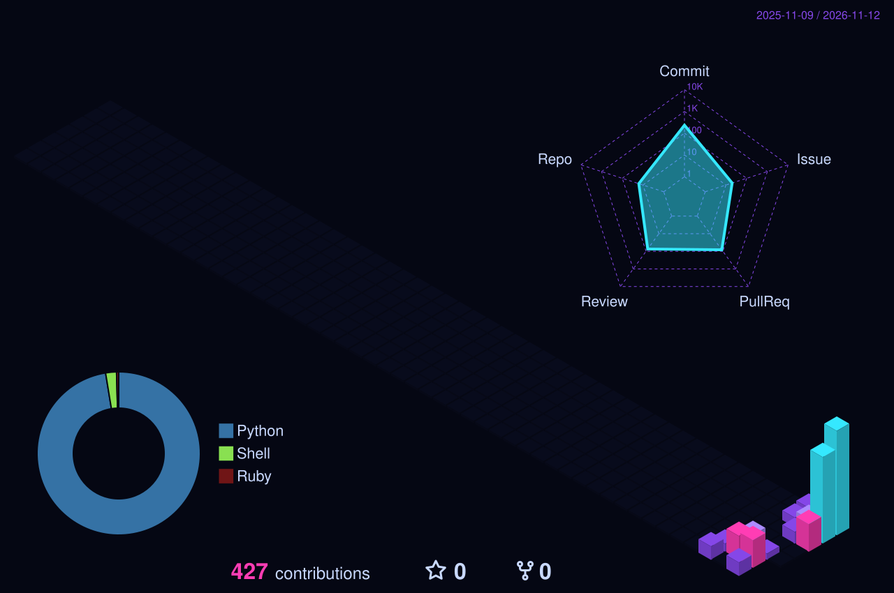

**My AI workspace, entirely in Terminal.** Fast local answers, a deeper Fable mode, searchable documents and research with sources you can inspect. The models run on your own computer, with no cloud.

  
  
  

  <a href="https://github.com/xzchick/envy-terminal"><b>Explore ENVY Terminal →</b></a> &nbsp; · &nbsp;
  <a href="https://github.com/xzchick/envy-terminal#install">Install on macOS, Windows or Linux</a> &nbsp; · &nbsp;
  <a href="https://github.com/xzchick/envy-terminal#commands">Command guide</a>

<b>See it in Terminal</b>

 

Fictional sample document; no personal data shown.

**Terminal-only password recovery for hashes you own or are authorized to test.** It validates hash files, identifies plausible formats and drives Hashcat or John the Ripper Jumbo, entirely on your own machine.

  
  
  

  <a href="https://github.com/xzchick/hash-audit"><b>Explore Hash Audit →</b></a> &nbsp; · &nbsp;
  <a href="https://github.com/xzchick/hash-audit#install">Install on macOS, Windows or Linux</a> &nbsp; · &nbsp;
  <a href="https://github.com/xzchick/hash-audit#formats">All 23 formats</a>

Local and offline. For hashes you own or are authorized to test; no online lookup, no account testing, no credential collection.

**Eleven tools** from the BLACK VEIL workshop, pulled out as **standalone desktop apps** — a real native window in the ENVY neon theme, with no Python to install. Each ships its own bundles for **macOS, Windows and Linux** through CI, and installs straight onto [BLACK VEIL](#veil) the OS.

<table>
  <tr>
    <td width="50%" valign="top">
      
      
<b>◇ ENVY Vault — keep it yours.</b> Passphrase-protected file encryption with AES-256-GCM and scrypt, in an animated native window. Each result goes to a new file; your original is never touched or overwritten.

      
<code>AES-256-GCM</code> <code>scrypt</code> <code>PyQt6</code> <code>offline</code>

      

        <a href="https://github.com/xzchick/envy-vault"><b>Explore Vault →</b></a> &nbsp;·&nbsp;
        <a href="https://github.com/xzchick/envy-vault#install">Install</a>
      

    </td>
    <td width="50%" valign="top">
      
      
<b>⬡ ENVY Cryptography Workbench — encode, cipher, analyze.</b> Base64 and hex, ROT and Atbash, chained into recipes with live output, plus a frequency/entropy analysis tab with a 26-shift ROT brute force. Honest by design: encodings, not encryption.

      
<code>Base64 · hex</code> <code>ROT · Atbash</code> <code>analysis</code> <code>no deps</code>

      

        <a href="https://github.com/xzchick/envy-crypto-workbench"><b>Explore Workbench →</b></a> &nbsp;·&nbsp;
        <a href="https://github.com/xzchick/envy-crypto-workbench#install">Install</a>
      

    </td>
  </tr>
  <tr>
    <td width="50%" valign="top">
      
      
<b>🗂 ENVY Casebook — case notes, kept honest.</b> Encrypted notes, entities, events and links with a hash-chained revision journal, a link chart and event timelines. Every save is a new encrypted revision; plaintext HTML/JSON export when you choose.

      
<code>AES-256-GCM</code> <code>hash chain</code> <code>link chart</code> <code>offline</code>

      

        <a href="https://github.com/xzchick/envy-casebook"><b>Explore Casebook →</b></a> &nbsp;·&nbsp;
        <a href="https://github.com/xzchick/envy-casebook#install">Install</a>
      

    </td>
    <td width="50%" valign="top">
      
      
<b>▦ ENVY Ops Desk — plan it locally.</b> Encrypted role aliases, assignments, progress, check-ins and acknowledgements with a hash-chained journal, computed due states and authenticated handoff bundles. A handoff proves the passphrase, not an identity.

      
<code>AES-256-GCM</code> <code>due states</code> <code>handoffs</code> <code>offline</code>

      

        <a href="https://github.com/xzchick/envy-ops-desk"><b>Explore Ops Desk →</b></a> &nbsp;·&nbsp;
        <a href="https://github.com/xzchick/envy-ops-desk#install">Install</a>
      

    </td>
  </tr>
  <tr>
    <td width="50%" valign="top">
      
      
<b>▧ ENVY Evidence Vault — follow the fingerprints.</b> Copied-file intake into an encrypted vault, keyed by the SHA-256 of each file's original bytes, with verification that re-hashes every object and a hash-chained custody journal. Integrity since intake — not origin.

      
<code>AES-256-GCM</code> <code>SHA-256</code> <code>custody log</code> <code>offline</code>

      

        <a href="https://github.com/xzchick/envy-evidence-vault"><b>Explore Evidence Vault →</b></a> &nbsp;·&nbsp;
        <a href="https://github.com/xzchick/envy-evidence-vault#install">Install</a>
      

    </td>
    <td width="50%" valign="top">
      
      
<b>◌ ENVY Veil — more than meets the eye.</b> Hide an AES-256-GCM encrypted file inside a lossless PNG, BMP or WAV carrier with LSB steganography, watch a live capacity meter, and reveal it with your passphrase. Honest by design: concealment is not the security — the encryption is.

      
<code>AES-256-GCM</code> <code>steganography</code> <code>PNG · WAV</code> <code>offline</code>

      

        <a href="https://github.com/xzchick/envy-veil"><b>Explore Veil →</b></a> &nbsp;·&nbsp;
        <a href="https://github.com/xzchick/envy-veil#install">Install</a>
      

    </td>
  </tr>
  <tr>
    <td width="50%" valign="top">
      
      
<b>◎ ENVY Integrity Monitor — know when something changes.</b> Baseline a folder's files by SHA-256 into an encrypted record, then detect exactly what was added, removed or modified since, with a hash-chained change journal and revision-preserving accepts. Honest by design: a difference proves change, not cause.

      
<code>AES-256-GCM</code> <code>SHA-256</code> <code>change journal</code> <code>offline</code>

      

        <a href="https://github.com/xzchick/envy-integrity-monitor"><b>Explore Integrity Monitor →</b></a> &nbsp;·&nbsp;
        <a href="https://github.com/xzchick/envy-integrity-monitor#install">Install</a>
      

    </td>
    <td width="50%" valign="top">
      
      
<b>⊚ ENVY Orbit — keep everything in orbit.</b> Track recurring obligations by cadence — rotate a key every 90 days, verify a backup weekly — log each completion into a hash-chained journal, and see what is overdue, due, soon or on track. Honest by design: it records that you logged it, not that you did it.

      
<code>AES-256-GCM</code> <code>hash chain</code> <code>cadence</code> <code>offline</code>

      

        <a href="https://github.com/xzchick/envy-orbit"><b>Explore Orbit →</b></a> &nbsp;·&nbsp;
        <a href="https://github.com/xzchick/envy-orbit#install">Install</a>
      

    </td>
  </tr>
  <tr>
    <td width="50%" valign="top">
      
      
<b>◈ ENVY SkyWatch — watch for what matters.</b> Keep an encrypted watchlist of terms — keywords or file hashes — then scan a file or folder offline and read every hit with its file, line and context, ranked by severity, with a hash-chained scan journal. Honest by design: a hit is a literal match, not a verdict.

      
<code>AES-256-GCM</code> <code>hash chain</code> <code>offline scan</code> <code>no deps</code>

      

        <a href="https://github.com/xzchick/envy-skywatch"><b>Explore SkyWatch →</b></a> &nbsp;·&nbsp;
        <a href="https://github.com/xzchick/envy-skywatch#install">Install</a>
      

    </td>
    <td width="50%" valign="top">
      
      
<b>✦ ENVY Oracle — hold yourself to your predictions.</b> Record a prediction with a confidence from 1 to 99 percent, resolve it yes or no, and see how well your confidence matched reality — Brier score, accuracy and a calibration table by band. Honest by design: it scores your foresight, it does not foretell.

      
<code>AES-256-GCM</code> <code>hash chain</code> <code>calibration</code> <code>offline</code>

      

        <a href="https://github.com/xzchick/envy-oracle"><b>Explore Oracle →</b></a> &nbsp;·&nbsp;
        <a href="https://github.com/xzchick/envy-oracle#install">Install</a>
      

    </td>
  </tr>
  <tr>
    <td width="50%" valign="top">
      
      
<b>⋔ ENVY Hypothesis — weigh the competing explanations.</b> List the competing hypotheses and the evidence, rate each evidence/hypothesis cell from very inconsistent to very consistent, and rank the hypotheses by how little the evidence contradicts them — the Analysis of Competing Hypotheses method. Honest by design: it structures your reasoning, it supplies no facts.

      
<code>AES-256-GCM</code> <code>ACH</code> <code>diagnosticity</code> <code>offline</code>

      

        <a href="https://github.com/xzchick/envy-hypothesis"><b>Explore Hypothesis →</b></a> &nbsp;·&nbsp;
        <a href="https://github.com/xzchick/envy-hypothesis#install">Install</a>
      

    </td>
    <td width="50%" valign="top" align="center">
      
      
<b>▚ ENVY BLACK VEIL — the OS they live on.</b> All eleven apps install onto <a href="#veil">BLACK VEIL</a>, my standalone Linux OS, with one command: <code>envy-tools install all</code>. Or run each on macOS and Windows too.

    </td>
  </tr>
</table>

  
  
  

Native windows, not browser views. Offline; no telemetry, no network, no accounts. Vault protects files; the Workbench is for reversible encodings and teaching ciphers, not security.

  
  

**My own Linux OS — now a standalone, buildable OS.** An **AlmaLinux 10 + KDE Plasma 6** desktop, themed end to end in the ENVY neon palette — GRUB, the Plymouth boot splash (with a LUKS passphrase prompt), the SDDM login, the desktop and the terminal. The [repo](https://github.com/xzchick/envy-black-veil) is the real build system: a live-ISO Kickstart, the theme packages, an ENVY-branded Calamares installer, and CI. BLACK VEIL ships as *just the OS* — a clean, focused base — and every ENVY tool installs onto it afterwards with one command, `envy-tools install all` (or pick your own: [Vault, the Cryptography Workbench, Casebook, Ops Desk, Evidence Vault, Veil, the Integrity Monitor, Orbit, SkyWatch, Oracle and Hypothesis](#apps)). It's built to be **portable** — install it onto an external SSD, HDD or USB drive and boot it on almost any PC. Encrypted and offline by design: SELinux enforcing, the firewall on, nothing listening.

<table>
  <tr>
    <td width="50%" valign="top">
      <a href="https://github.com/xzchick/envy-black-veil"></a>
      
<b>A desktop with its own identity.</b> AlmaLinux + KDE Plasma, searchable utilities, live command output, and a cohesive dark interface.

      
<code>AlmaLinux</code> <code>KDE Plasma</code> <code>Python</code> <code>RPM</code>

    </td>
    <td width="50%" valign="top">
      <a href="https://github.com/xzchick/envy-black-veil"></a>
      
<b>Make recovery visible.</b> A 1,024-block recovery map driven by GNU ddrescue progress for disk-image recovery.

      
<code>Python</code> <code>Qt</code> <code>GNU ddrescue</code>

    </td>
  </tr>
</table>

<a href="https://github.com/xzchick/envy-black-veil"><b>Explore BLACK VEIL →</b></a>

<b>Inside the workshop — development screenshot</b>

 

[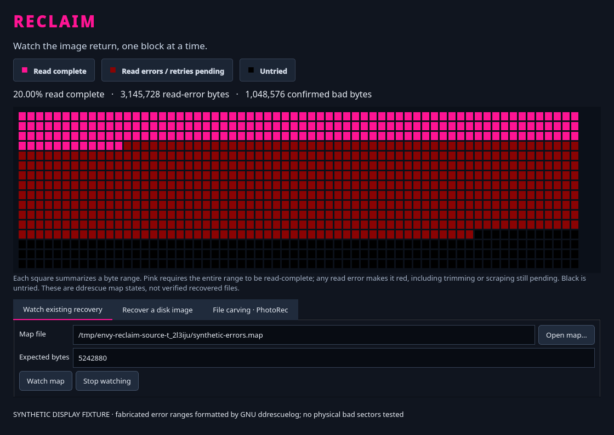](./reclaim-development.png)

Synthetic recovery-map test data; not a real disk recovery result.

  <code>printf '%s\n' 'curiosity → experiments → useful tools'</code> 
  The portable tools are moving to <a href="#apps">standalone apps</a>; the Linux desktop is still coming together.

  <b>CURRENT FOCUS</b> &nbsp; Installation · recovery · desktop integration · testing

---

  
  
  
  
  

  

